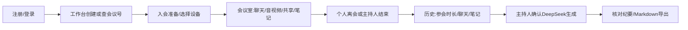
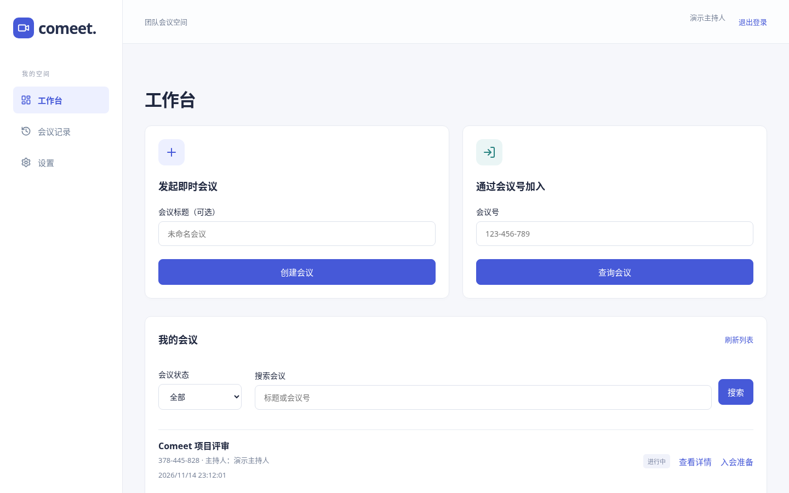
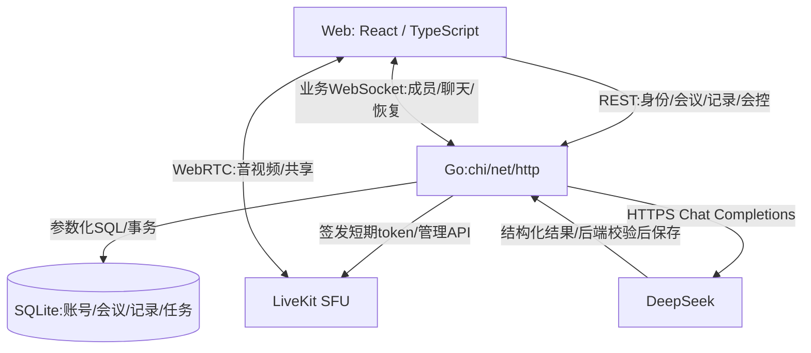
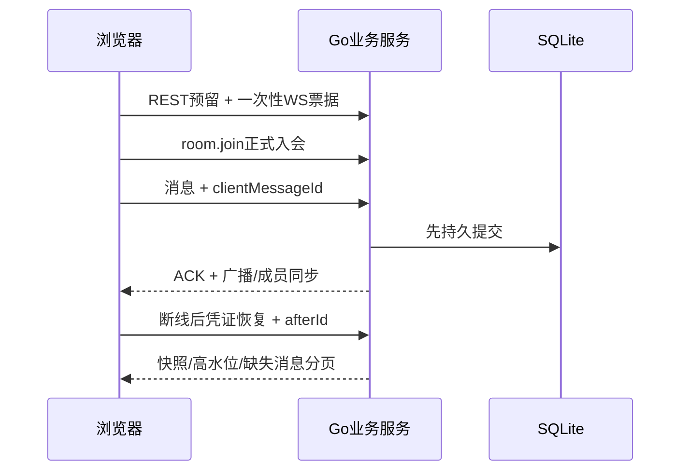
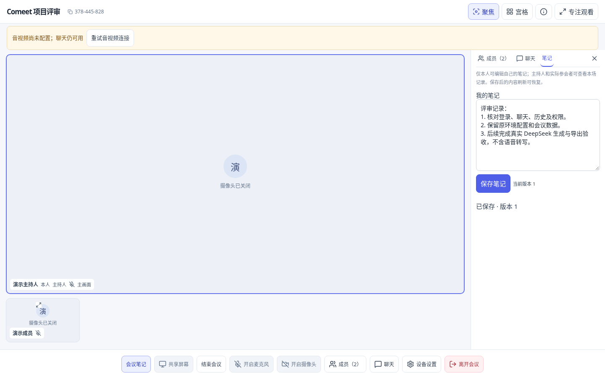
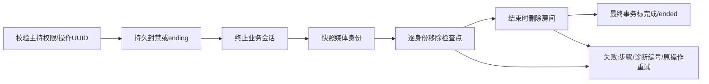
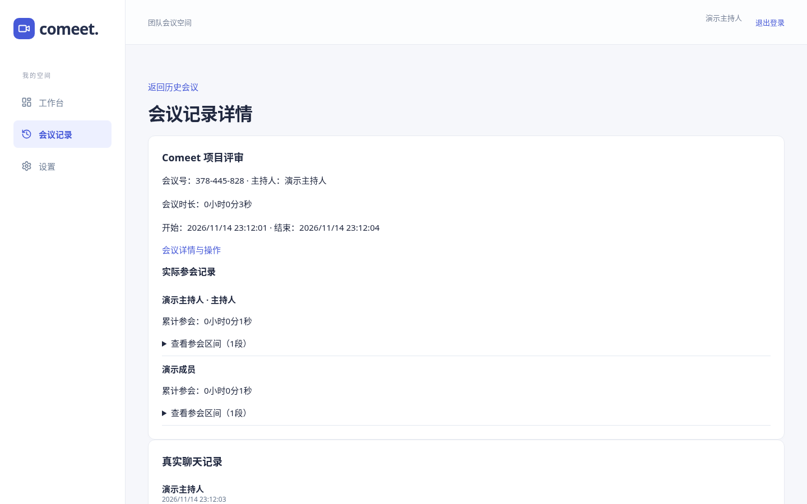
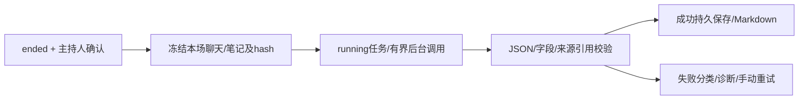
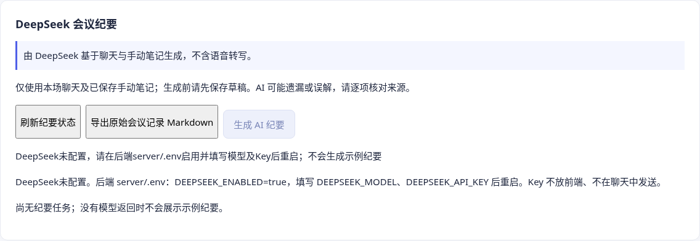

# 01 · Comeet：小组会议与记录

**目标：让2–6人完成“入会协作 → 留下记录 → 会后整理”。**

- 场景：课程讨论、小组评审；桌面Chrome/Edge优先。
- 实现：React/TypeScript、Go、SQLite、LiveKit、DeepSeek。
- 取舍：单实例、明确权限、可恢复操作；不做录音或语音转写。
- 本文是Markdown幻灯片：以 `---` 分页，每页一个主题；代码与图表均对应实际实现。

交付版本 · 2026-11-14 · **人工复验已获用户确认，未公开部署**

---

# 02 · 完成范围与证据边界

| 范围 | 实际状态 |
|---|---|
| 账号、会议、成员聊天、音视频、共享、主持会控 | 已实现；第一至第五阶段已有用户人工确认 |
| 历史、笔记、设备与稳定性 | 已实现；第六阶段会议室修复7项人工通过，其余有自动/进程证据 |
| DeepSeek纪要、任务与导出 | 已实现；用户已确认真实DeepSeek成功生成与人工核对通过 |
| 本次最终回归/交付 | 自动结果见第15页；Windows、物理设备与真实媒体复验已获用户确认 |

**代码完成、自动通过、人工通过是不同结论。** 不用测试fixture冒充真实模型或媒体。

证据：[阶段验收](docs/阶段验收.md) · [最终验收](docs/最终验收与交付.md)

---

# 03 · 用户流程

主持人和实际参会者才可查看历史；准备/预留不算实际参会。个人离会不结束整场会议。

---

# 04 · 整体架构与职责

- Web负责交互与媒体订阅；Go负责权限、持久化和第三方密钥。
- 媒体直达SFU；聊天走业务WS；纪要只发送聊天与已保存笔记。
- 选择独立职责便于故障隔离。替代：Node后端/PostgreSQL/自建SFU；本项目保留Go单实例与SQLite的较低运维成本。

| 技术是什么 | 用法/原理与选择 | 替代方案 |
|---|---|---|
| React组件库 + TypeScript静态类型 | 状态驱动组件更新；类型在编译时检查接口。Room组合媒体/面板，避免交互与连接生命周期混在一起 | Vue同样适合；纯JavaScript少一层编译期检查 |
| Go + chi HTTP路由 | net/http处理REST/WS，goroutine配合context做有界后台调用；便于单二进制和Windows交付 | Node.js可复用前端语言，本项目采用Go既有实现 |

代码：[http](server/internal/http) · [realtime](server/internal/realtime) · [summary](server/internal/summary)

---

# 05 · 登录鉴权：JWT与可撤销会话

| 是什么/原理 | 实际用法与问题解决 | 选择与替代 |
|---|---|---|
| bcrypt：带盐的慢密码哈希 | 注册保存哈希，不保存明文；登录校验 | 直接采用成熟实现；替代Argon2需另行调参 |
| JWT HS256：签名身份声明 | 校验签名/算法、iss/aud、iat/exp、sub/sid | 方便REST与WS握手；不是仅解码后信任客户端 |
| auth_sessions：服务端会话状态 | 每次认证核对未撤销/未到期；退出撤销sid | 支持即时退出；替代纯无状态JWT会削弱撤销能力 |

- 浏览器用sessionStorage保存当前标签登录；默认8小时，无刷新令牌。
- JWT_SECRET稳定保留在server/.env；重启不旋转。
- 替代Cookie会话可减少脚本直接读取token，但需补充CSRF等设计；本次未改认证方案。

代码：[auth.go](server/internal/auth/auth.go) · [Protected.tsx](web/src/components/Protected.tsx)

---

# 06 · 会议权限与并发一致性

- 内部UUID用于关联；9位会议号用于查找，不是访问凭证。
- 准备信息最小化；历史复用主持人/实际成员校验。
- 主持人操作由Go再次检查host_user_id，隐藏按钮不构成权限控制。
- join事务检查会议状态、封禁、容量和有效登录；部分唯一索引约束同用户有效会话。
- 创建和操作使用请求UUID去重；预留60秒，同一请求重试不无限延长席位。

**原理与选择：** 数据库事务/约束守住并发边界；前端防重复点击改善体验。单进程锁用于协调业务，不替代持久约束。

替代：多实例需要共享锁/状态或数据库并发方案；当前不声称支持水平扩展。

代码：[meeting.go](server/internal/meeting/meeting.go) · [002迁移](server/migrations/002_accounts_meetings.sql)

---

# 07 · WebSocket：同步与断线恢复

- WS是双向长连接：减少轮询延迟；业务成员与聊天不依赖SFU。
- UUID与服务端ID去重，失败重试原消息；45秒恢复宽限保持同一参会区间。
- generation防旧连接回调误伤新连接；重启保留原断线期限。
- 替代HTTP轮询更简单但延迟与请求量较高；Redis跨实例广播本次未实现。

代码：[room.ts](web/src/services/room.ts) · [realtime](server/internal/realtime)

---

# 08 · WebRTC、SFU与真实共享

| 技术 | 怎么用/原理 | 为什么选/替代 |
|---|---|---|
| WebRTC | 浏览器协商并传输实时音视频；网络质量影响ICE/媒体连通 | 浏览器标准能力；不能用业务WS替代成熟媒体传输 |
| LiveKit SFU | 发布者上传，SFU按订阅转发；Go签发最小权限短期token | 小组会议减少mesh逐人上传负担；自建SFU运维成本更高 |
| 摄像头/屏幕轨道 | 摄像头与共享独立发布，屏幕选择由用户授权 | 用户可以分别开关；不录制、不转写 |

实现默认720p30、VP8/Simulcast，配合adaptiveStream/dynacast；实际协商取决于浏览器、网络与SFU。

共享处理取消选择、系统停止、发布失败和离会清理；远端共享完整显示、不裁切、不镜像。真实媒体已有用户历史验收，本次云环境未再次验证SFU互通。

代码：[media.ts](web/src/services/media.ts) · [MediaRoom.tsx](web/src/components/MediaRoom.tsx)

---

# 09 · 主画面、浅色布局与设备管理

- 来源键为“参会身份 + camera/screenShare”；同一成员的摄像头和共享可分别选择。
- 自动模式优先共享；手动固定优先，停止所选共享后回退。
- 聚焦/宫格与面板是界面状态，不用于重新创建媒体连接。
- devicechange刷新列表；设备断开提示，用户手动切换；关闭状态不自动采集。
- 释放采集轨道、音频挂载、监听和AudioContext，避免重复声音或迟到采集泄漏。

选择单一来源模型便于多共享源扩展；仅用CSS切换无法表达固定/失效回退规则。设备能力、输出切换依赖浏览器支持。

代码：[roomView.ts](web/src/services/roomView.ts) · [Room.tsx](web/src/pages/Room.tsx)

---

# 10 · 主持人会控与失败重试

- 静音是一次操作，成员可自行开麦；不远程强制开麦。
- 移出/结束先确认，执行结果右下通知；持久待处理项仍在成员/详情。
- 已完成清理不重放；官方not_found按目标已不存在处理；其他错误不忽略。
- 每调用6秒、每次处理8秒预算，超时后继续剩余步骤；禁止重入状态不会回滚。

选择持久检查点解决原整批反复超时；替代通用任务队列适合更大规模，本项目未引入。

代码：[cleanup.go](server/internal/realtime/cleanup.go) · [moderation.go](server/internal/realtime/moderation.go)

---

# 11 · 数据持久化与个人笔记

| 数据/技术 | 实现与原理 | 选择/替代 |
|---|---|---|
| SQLite + database/sql | 单连接、WAL、外键、busy_timeout；参数化SQL | 无额外服务，适合单实例；高并发可考虑PostgreSQL |
| 001–007增量迁移 | SQL内嵌，事务应用并记录版本 | 可升级旧数据；不以删库代替迁移 |
| 个人笔记CAS | JWT决定作者；version匹配才更新，冲突409 | 保留本地草稿、人工选择；协同CRDT不在范围 |

面板切换只隐藏已挂载笔记，草稿不丢；刷新恢复的是已保存内容。日常备份须保留整个data及稳定.env。

代码：[store.go](server/internal/store/store.go) · [records.go](server/internal/meeting/records.go) · [ManualNotes.tsx](web/src/components/ManualNotes.tsx)

---

# 12 · 历史记录与真实参会时长

- 列表支持状态/标题/会议号筛选和分页；详情按实际权限查询。
- 时长来自attendance_intervals，短暂重连不重开区间，多次主动进出累计。
- 准备/预留不算参会；结束会议使用ended_at冻结时长。
- 聊天为持久消息，原ID失败重试不重复插入；个人笔记保留作者与版本。

实现：[HistoryPage.tsx](web/src/pages/HistoryPage.tsx) · [records_test.go](server/internal/http/records_test.go)

---

# 13 · DeepSeek：来源、任务与安全校验

- DeepSeek是语言模型：按输入上下文生成文本；本项目用Go net/http请求Chat Completions，不接收现场音频。Key只在后端，页面不显示模型与输入预算。
- 同场1任务、全局2槽；同源成功复用，明确重生成才再调用，合并请求编号也持久去重。
- 后端预算保留；不静默截断。责任人/日期未明确为null，引用必须来自冻结记录。
- 前端纯文本显示；导出含原始来源、模型/时间/hash，转义HTML。失败不生成假纪要。

选择结构化JSON与引用以便核对；自由文本解析更脆弱。结构合法仍不能证明语义准确；语音转写本次未实现。

代码：[summary](server/internal/summary) · [AISummaries.tsx](web/src/components/AISummaries.tsx)

---

# 14 · AI当前运行状态：如实展示

**由 DeepSeek 基于聊天与手动笔记生成，不含语音转写。**

- 早期真实调用曾报AI_INVALID_RESULT，诊断已补齐；用户现已确认真实成功生成与人工核对通过。
- 此云环境未配置真实Key；HTTP fixture验证接口/故障处理，不代表真实模型通过。
- 不在幻灯片展示密钥、token或未授权会议内容；用户已完成人工核对；不据此推定所有未来内容或费用场景均验证。

---

# 15 · 最终检查结果

| 检查 | 当前证据 |
|---|---|
| Go普通/race、vet、模块校验 | 本次普通/race/vet/模块校验通过，含历史/权限、会控检查点和纪要失败恢复 |
| 前端lint、类型检查、生产构建 | 通过；lint零警告、生产构建保留大chunk提示，详见最终记录 |
| 浏览器完整回归/设备与媒体故障 | 完整62项通过（1.8m）；独立媒体未配置1项通过；与真实SFU/模型验证分开 |
| Windows可运行性 | 云端amd64无CGO交叉编译通过；用户确认当前Windows实机复验通过 |
| 真实媒体/模型 | 用户确认当前真实媒体、物理设备及DeepSeek成功/人工核对通过；云端不冒称真实服务实测 |

当前截图来自独立测试账号创建的真实SQLite记录；虚拟设备/模型fixture仅位于测试链路。完整日志结果和人工清单见最终记录，不把自动通过扩大成人工通过。

---

# 16 · Windows运行与数据升级

1. 安装Node.js24、Go>=1.26.8，保留原server/.env与整个server/data。
2. server目录：`go mod download`；首次用 `-init-env`补JWT，然后 `go run ./cmd/server -env-file .env`。
3. web目录：`npm.cmd ci`、`npm.cmd run dev`；访问 http://localhost:5173。
4. A/B独立浏览器；媒体与AI自行在后端私有.env配置，配置后重启Go。
5. 停止用Ctrl+C；重启不删库、不旋转JWT_SECRET，自动补齐未应用迁移。

升级与完整路径：[README](README.md)。未知模型响应先查诊断，不连续付费重试。

---

# 17 · 已知限制与后续扩展

- 单实例/SQLite单连接、2–6人目标；并非分布式会议平台。
- 无录音、语音转写、实时字幕、刷新令牌或通用分布式任务队列。
- 设备权限、自动播放、输出选择及共享选择受浏览器/系统限制；跨机器需HTTPS与网络配置。
- AI仅看聊天与已保存笔记，可能遗漏或误解；不自动分块、不保证语义正确。
- 当前完整应用未公开部署；历史Pages旧静态预览不代表本版本上线。

可选后续：真实模型提示优化、更多浏览器与网络实测、PostgreSQL/共享状态扩容、HTTPS部署。**这些不计入本次已实现范围，也不在本次执行。**

---

# 18 · 交付与最终确认

- 交付位置：`week03/homework/comeet`；包含源码、迁移、锁文件、测试、模板和本文。
- 不包含真实.env、Key、运行数据库、依赖目录、编译产物或临时文件。
- [最终端到端人工清单与实测结果](docs/最终验收与交付.md)：逐项确认账号→会议→媒体/共享→会控→历史→纪要→导出。
- 真实DeepSeek成功与人工核对、当前Windows/物理设备/真实媒体复验已由用户确认；不扩展到未说明的网络和设备。

**已记录用户人工验收通过；另获授权推送final-review提供源码下载，不部署应用。目标学校仓库另候指定。**
