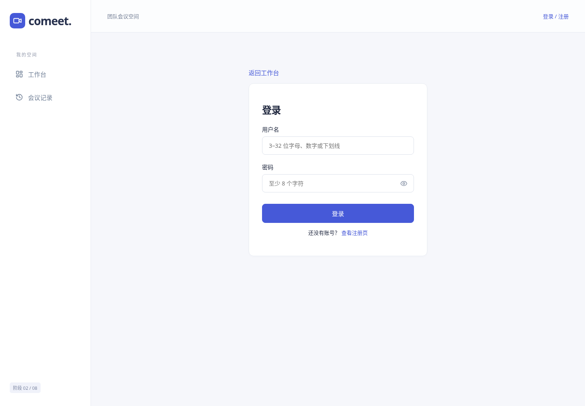
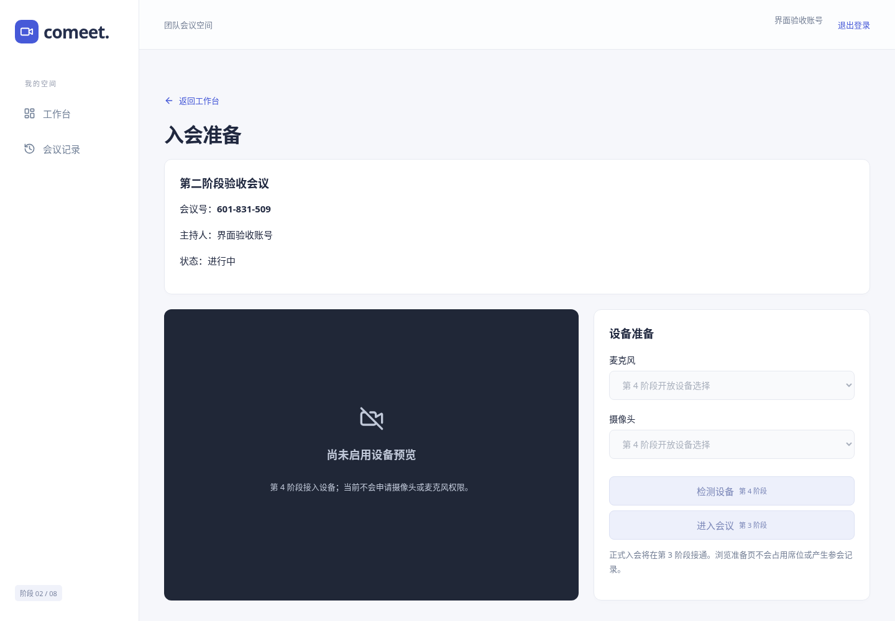
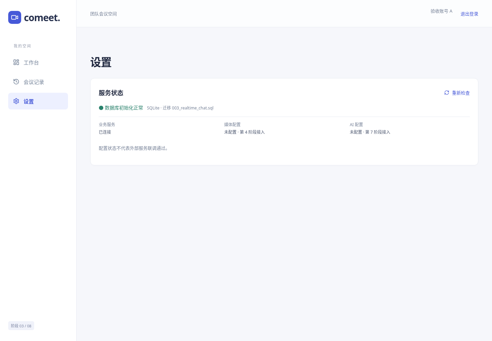

# Comeet 技术方案 · 第三阶段

目标为单实例、桌面 Chrome/Edge 优先的 2–6 人课程会议。前两阶段人工验收已通过；第三阶段代码完成待人工验收。此方案不声称后续能力已实现。

| 范围 | 状态 |
|---|---|
| React 路由/响应式、Go 配置/health、SQLite 迁移 | 第一阶段已人工验收通过，第二阶段回归覆盖 |
| 注册/登录、bcrypt、JWT/sid 撤销、保护/过期跳转 | 第二阶段已验收 |
| 真实工作台、创建/会议号查询、详情权限、入会预留 | 第二阶段已验收 |
| WS 成员/聊天/正式参会/重连 | 第三阶段完成，待人工验收 |
| LiveKit/WebRTC/SFU/设备/媒体 token | 第四阶段未开始 |
| 屏幕共享/一次静音/移出/结束 | 第五阶段未开始 |
| 历史内容/笔记/稳定性 | 第六阶段未开始 |
| DeepSeek 纪要/Markdown 导出 | 第七阶段未开始 |
| 最终生产/HTTPS 方案与完整回归 | 第八阶段未开始 |

## 当前页面与架构

React/TypeScript + React Router + Zustand；CSS 变量/普通 CSS 保持既有浅色工作台和深色会议骨架，不放宣传标语。fetch 封装稳定 DTO、10 秒超时、401 清理及友好错误。Zustand 只持有当前标签身份和验证状态，sessionStorage 保留刷新，不用 localStorage 长期存 JWT。

浏览器 → Vite /api 代理 → Go net/http + chi → database/sql + modernc SQLite。纯 Go 驱动减少 Windows CGO 安装成本，适合单实例课程项目，不代表支持分布式。后端职责拆分 auth/meeting/http/store/config，未机械生成空业务包。

匿名访问工作台/准备/详情转登录，保留目标地址；注册成功转登录，正常登录后查 /me、设置到期计时，服务端 401 清理并转登录。工作台从 SQLite 加载本人创建/实际参加的会议，可按状态/标题过滤与游标分页；创建获取真实会议号，准备页只显示最小信息，不占席位、不申请媒体。进入会议按钮已接通第三阶段正式入会。

## 身份与数据

bcrypt cost=10，用户名 ASCII 3–32 并小写规范化唯一；显示名 1–32 字符；密码至少 8 字符、UTF-8 <=72 字节。JWT HS256 含 sub/sid/iss/aud/iat/exp，每个请求校验算法/签名/时间/发行者/受众及 auth_sessions 的未撤销和未到期状态。默认 8 小时，无刷新令牌。退出撤销当前 sid 并释放未入会预留。密码、原始 JWT 不存日志，auth_sessions 不存明文 JWT。

JWT_SECRET 是本机私有且稳定的 32+ 字节值。初始化命令仅在缺失/空时生成随机值，保留有效旧值；重启不旋转、不把公开示例当密钥。真实秘密/.env/data 不入仓库。

SQLite 单连接启用 WAL、foreign_keys、busy_timeout=5000；002 追加账号/会话/会议/成员/预留/封禁及索引，不改 001、不删除原数据。Migration 内嵌编译，schema_migrations 事务记录，重启不重复迁移。

## 幂等、权限和容量

会议内部 UUID 与 9 位 crypto/rand 会议号分开，数据库 UNIQUE 冲突可重试，媒体房间预留名称使用不透明内部 ID。创建绑定真实主持人和 clientRequestId，相同内容同请求返回原会议，换内容拒绝。标题最多 80 字符，所有 SQL 参数化，JSON body 有限且未知字段拒绝。

详情和列表只允许主持人或实际 meeting_members；知道会议号仅取得最小准备信息。准备与 joining 预留不会写入会历史。join 事务校验 active、sid、封禁、唯一性和容量，部分唯一索引保证同用户有效会话最多一份，8 并发抢 6 席测试通过。预留 60 秒，下一次 join 惰性释放过期记录；同请求重试不延长有效期，过期旧请求不复活。随机 session UUID 加域分离 HMAC 产生不可预测且可重现的恢复凭证，数据库只存 hash。

当前真实 WS/聊天和参会记录已接通，媒体连接尚未开发。测试 fixture 仅用于隔离测试。

## 测试与发布边界

Go 25 顶层测试（另含8个 JWT 子用例），race/vet/mod verify、Linux/Windows 纯 Go 构建通过。45 项真实浏览器检查通过，包括双用户/权限、4 宽度与页面刷新。实际进程 SIGTERM/重启验证账号、JWT 会话、会议和预留保留。具体证据和人工待测项见 docs/阶段验收.md。

GitHub Pages 仅发布静态界面，不运行 Go/SQLite；静态模式使用 HashRouter，明确不连接后端、不返回假成功。不能用 Pages 的界面预览代替第二阶段账号验收。完整后端尚无公网 HTTPS 部署，业务 WS 已本机联调；LiveKit/DeepSeek 未接入；这些属于后续阶段，必须逐阶段人工确认。

JWT、业务 WS 与后续 WebRTC、SFU、LiveKit、DeepSeek 各自职责仍依 v2.0 规格。一次静音不是持续禁言，AI 只基于聊天与手动笔记且不含语音转写；当前不实现这些能力。最终交付学校仓库只放 comeet 文件夹，全部阶段完成后清理 UI 阶段提示，参见交付检查。

## 实际界面截图

截图使用单独创建的真实测试账号和 SQLite 会议，不是内置演示账号或正常启动种子，密码/令牌均未展示。

## 第三阶段业务实时链路

REST 预留 → 30 秒一次性票据 → 同源 WebSocket → room.join 正式入会；SQLite 持久化成员、参会区间、聊天。聊天先提交再广播，以客户端 UUID 和服务端 ID 双层去重；历史分页最大100。快照高水位配合 afterId 分页避免断线只恢复最后50条。45秒宽限内恢复同一区间，超过宽限终结旧会话；重启先把 online 转为 reconnecting，不重置已有断线起点。连接 generation/指针防旧连接误删新连接。业务连接单实例，不引入 LiveKit/DeepSeek。

