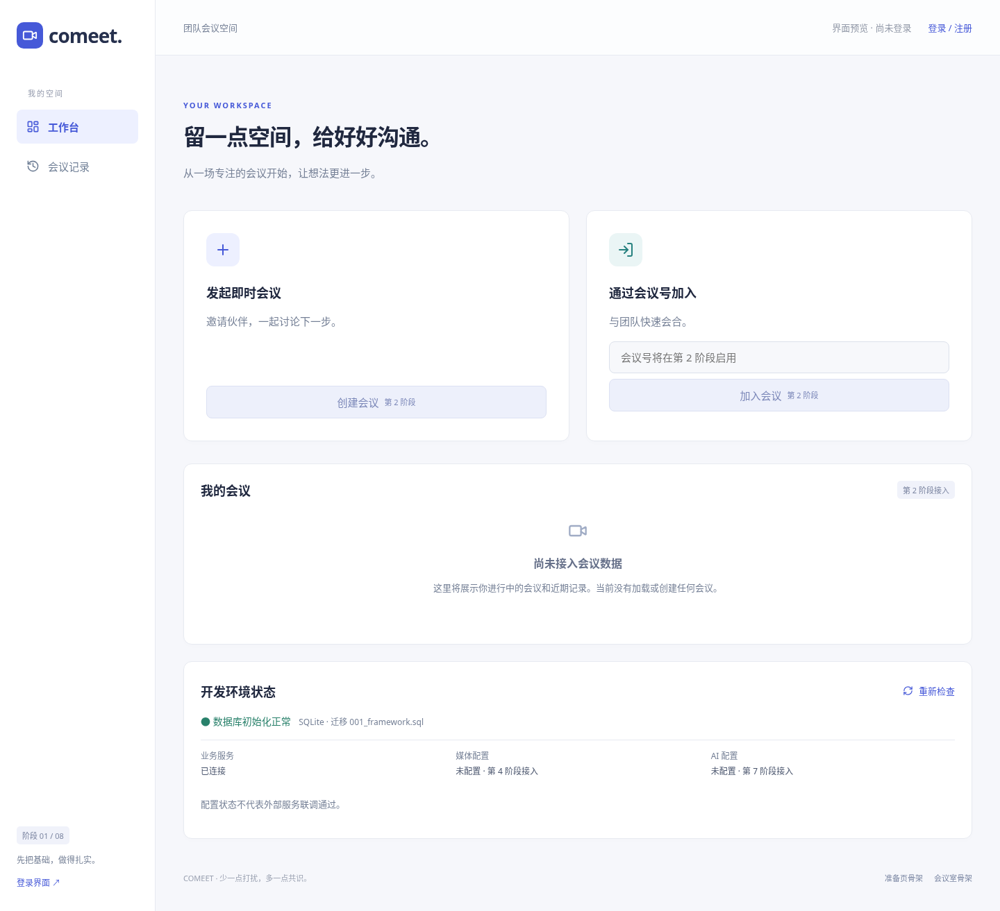
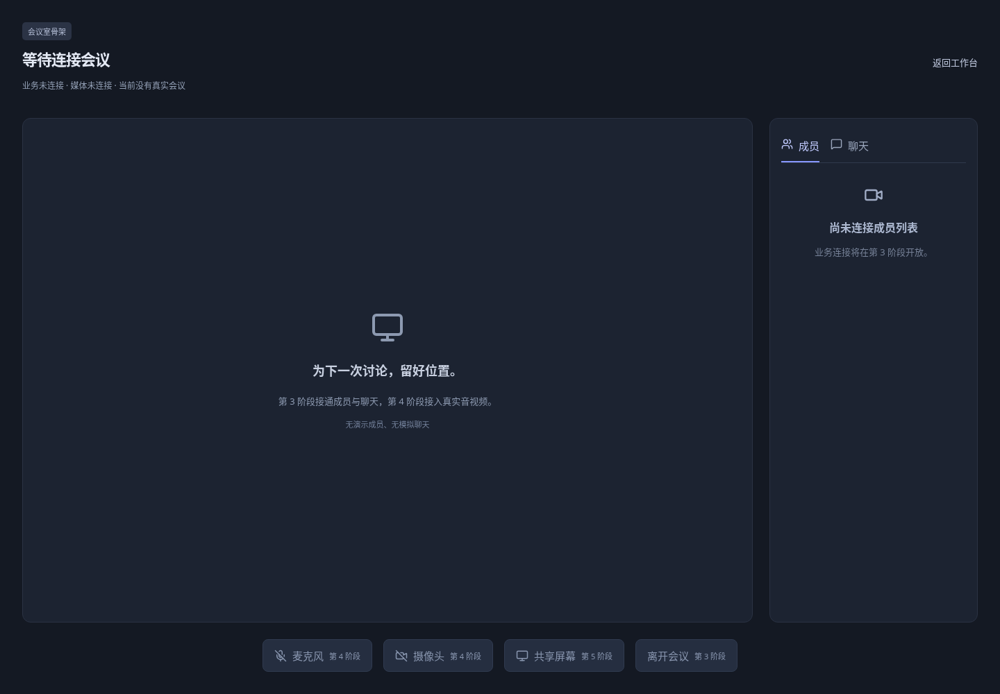

# Comeet 技术方案（第 1 阶段初稿）

目标是单实例、桌面浏览器优先的 2–6 人课程会议项目。本稿仅反映已实现的第 1 阶段，不代表最终产品完成。

| 能力 | 当前状态 |
|---|---|
| React 路由、公共布局、响应式基础 | 已实现 |
| Go 配置、统一响应、health | 已实现 |
| SQLite 连接、编号迁移、重启保留 | 已实现 |
| 登录、JWT、会议 REST | 第 2 阶段，未实现 |
| 业务 WS、聊天 | 第 3 阶段，未实现 |
| LiveKit / WebRTC / SFU 音视频 | 第 4 阶段，未实现 |
| 共享及主持人会控 | 第 5 阶段，未实现 |
| 历史、笔记和稳定性 | 第 6 阶段，未实现 |
| DeepSeek、Markdown 导出 | 第 7 阶段，未实现 |
| HTTPS 实际部署 | 未部署；最终阶段编写方案，实际部署另行授权 |

## 当前架构与页面

浏览器 React → Vite /api 代理 → Go net/http + chi → database/sql + modernc SQLite。React 管理 UI，TypeScript 提供 DTO 类型检查，React Router 提供深层路由；普通 CSS 使用靛蓝、浅灰背景、12px 圆角，会议室深色。此阶段不需要状态库，后续跨页面会话再使用 Zustand，避免不必要状态和依赖。

工作台 → 登录/注册（外观）或准备页/会议室（骨架）；历史页只显示阶段说明，没有伪造记录。所有业务按钮禁用并标阶段。准备页不申请设备权限，会议室不展示假视频。

实际截图在 docs/screenshots，自动验证范围和结果见 docs/阶段验收.md。桌面侧栏在窄屏变为顶部导航，主操作单列；会议室窄屏面板在主区域下方，尚无真实聊天抽屉业务。

## 存储与接口

SQLite 无需单独服务，modernc 提供纯 Go 驱动，降低 Windows CGO 安装成本；相比 PostgreSQL，适合此课程项目单实例，不能据此声称支持分布式。单连接简化写入，WAL/foreign_keys/busy_timeout 在连接初始化设置。schema_migrations 记录 SQL 文件名及 UTC Unix 毫秒时间；app_metadata 是真实框架元数据，无用户、会议或聊天种子数据。

health/live 检查进程；health/ready 实际查询迁移表，数据库错误返回 503，可选媒体/AI 未配置仍然返回 200。所有 API 使用 code/message/data/requestId；404/405 同样返回统一结构。不暴露数据库绝对路径或秘密。

## 后续技术选择及边界（尚未实现）

JWT 用于有期业务身份，auth_sessions 支持撤销，不做刷新令牌。Go 业务 WebSocket 处理成员和聊天；LiveKit SDK 负责 WebRTC 协商，由 SFU 转发多人媒体，避免自研 SFU。SQLite 保存业务历史，不用 LiveKit 数据通道替代业务 WS。未来 Go 调用 LiveKit 管理 API，前端 token 不含管理权限。一次静音不是持续禁言。

DeepSeek 由 Go HTTP 客户端在第 7 阶段调用，仅使用聊天和手动笔记，不含语音转写；当前没有 AI 输出、转写或录制。重连、聊天去重、离会资源清理、对象权限与媒体撤销均等待相应阶段实现并真实验证，不能用当前骨架推断其正确。

最终部署拟采用 HTTPS 静态站点与 Go API 反向代理、独立 LiveKit Cloud；当前只提供 localhost 开发服务器，没有公网地址或实际生产部署。当前测试不代表 Windows 实机、真实音视频、跨网络互通或模型联调通过。

## 第 1 阶段实际界面

